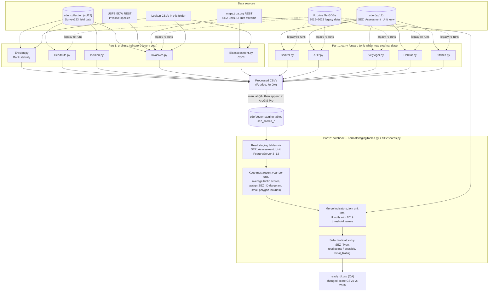
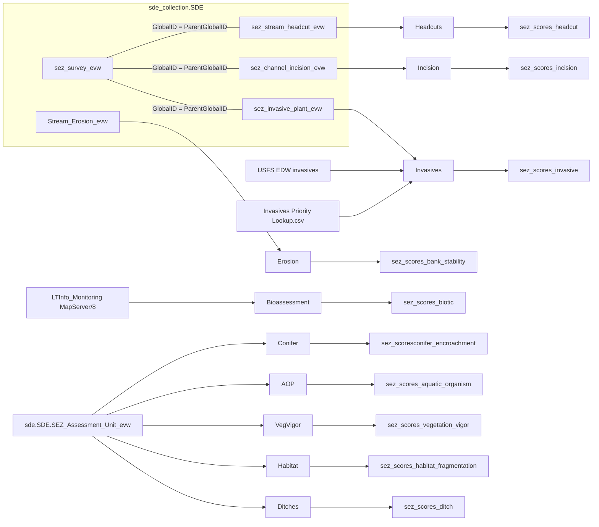

# SEZ Scripts: Workflow and Data Sources

These scripts score Stream Environment Zone (SEZ) assessment units for the threshold evaluation. Each indicator script pulls raw or previously scored data, grades it A–D, converts the grade to points, and writes a CSV for QA. The QA'd results are appended to the indicator **staging tables** in `sde.Vector`. The notebook then reads every staging table back, merges them per assessment unit, fills gaps with the 2019 threshold values, and calculates the final SEZ rating.

`notebook.ipynb` is the driver. Run it top to bottom:

- **Part 1:** process each indicator and post it to staging.
- **Part 2:** combine the staging tables and compute the final scores.
- **QA tools:** compare the new ratings against 2019.

## Workflow

## Data flow per indicator

## Script reference

| Script | Function the notebook calls | Reads | Writes |
|---|---|---|---|
| `utils.py` | imported by every script | Connection paths, lookup CSVs, grading functions | — |
| `Erosion.py` | `get_erosion_data`, `process_grade_erosion(df, year)` | `sde_collection.SDE.Stream_Erosion_evw` | `processederosiondata_{year}.csv` |
| `Headcuts.py` | `get_combined_survey_and_headcut_data`, `process_grade_headcut(df, year)` | `sez_survey_evw` + `sez_stream_headcut_evw` | `processedheadcutdata_{year}.csv` |
| `Incision.py` | `get_combined_survey_and_incision_data`, `process_grade_incision(df, year)` | `sez_survey_evw` + `sez_channel_incision_evw` | `processedincisiondata_{year}.csv` |
| `Invasives.py` | `get_USFSinvasive_data`, `get_combined_survey_and_invasive_data`, `merge_format_prioritize_invasive`, `process_grade_invasives`, `final_format_invasive` | `sez_survey_evw` + `sez_invasive_plant_evw`, USFS REST, SEZ units REST, priority CSV | `processedinvasivedata_{year}.csv` |
| `Bioassessment.py` | `get_bioassessment_data`, `process_grade_bioassessment(df, year)`, `post_bioassessment` | LT Info streams MapServer/8 spatially joined to SEZ units | `processedbioassessmentdata.csv`, or `sez_scores_biotic` when `draft=False` |
| `Conifer.py` | `get_conifersez_data_sql`, `process_conifer`, `post_conifer_data` | `sde.SDE.SEZ_Assessment_Unit_evw` | `processedconiferdata.csv`, or `sez_scoresconifer_encroachment` |
| `AOP.py` | `get_aopsez_data_sql`, `Process_aop` | `SEZ_Assessment_Unit_evw` (latest `Threshold_Year`) | Posting is commented out |
| `VegVigor.py` | `post_Veg_data` | `AssessmentUnits_Master` (legacy GDB) | `processedvegvigdata.csv`, or `sez_scores_vegetation_vigor` |
| `Habitat.py` | Not called. The notebook updates this table manually. | `SEZ_Assessment_Unit_evw` or `AssessmentUnits_Master` | `processedHabFragdata.csv`, or `sez_scores_habitat_fragmentation` |
| `Ditches.py` | Not called. The notebook updates this table manually. | `SEZ_Assessment_Unit_evw`, `stage_ditches_evw` or `AssessmentUnits_Master` | — |
| `FormatStagingTables.py` | `average_biotic_scores`, `process_data`, `field_mapping` | Staging DataFrames | — |
| `SEZScores.py` | `get_score_columns`, `calculate_scores` | Merged DataFrame | — |

## Inputs and paths

### Database connections (`utils.py`)

| Input | Path / value | Used for |
|---|---|---|
| Connection file folder | `F:\GIS\DB_CONNECT` | — |
| Vector SDE connection | `F:\GIS\DB_CONNECT\Vector.sde` | Staging tables (`sez_scores_*`) and `sde.SDE.Monitoring\sde.SDE.Stream` |
| Collection SDE connection | `F:\GIS\DB_CONNECT\Collection.sde` → `sde.SDE.Survey` | arcpy paths to raw survey feature classes |
| SQL Server (pandas) | Server `sql12`, databases `sde` and `sde_collection`, ODBC Driver 17, Windows auth | `get_conn('sde')`, `get_conn('sde_collection')` |

### SQL tables

| Table | Database | Fields pulled | Script |
|---|---|---|---|
| `SDE.sez_survey_evw` | sde_collection | `GlobalID, Assessment_Unit_Name, survey_date`, plus `headcuts_number_of_headcuts`, `incision_ratio`, `invasives_*` | Headcuts, Incision, Invasives |
| `SDE.sez_stream_headcut_evw` | sde_collection | `ParentGlobalID, headcut_depth` | Headcuts |
| `SDE.sez_channel_incision_evw` | sde_collection | `ParentGlobalID, bankfull_depth, depth_top_bank, bankfull_ratio, created_date` | Incision |
| `SDE.sez_invasive_plant_evw` | sde_collection | `ParentGlobalID, invasives_percent_cover, invasives_plant_type, invasive_type_other, created_date` | Invasives |
| `SDE.Stream_Erosion_evw` | sde_collection | `Assessment_Unit_Name, SHAPE.STLength(), Bank_Type, Survey_Date` | Erosion |
| `SDE.SEZ_Assessment_Unit_evw` | sde | Prior indicator values (AOP, Conifer, Ditches, Habitat Frag, Veg Vigor) | AOP, Conifer, Ditches, Habitat |
| `SDE.stage_ditches_evw` | sde | Ditches staging values | Ditches (`get_stageditch_data_sql`, not called) |
| `SDE.AquaticOrganismPassage_USFS_evw` | sde | `Total_Mile, Number_Bar, Structures` | AOP (`get_USFSAOP_data`, not called) |

### REST services

| Service | URL | Used for |
|---|---|---|
| SEZ assessment units | `https://maps.trpa.org/server/rest/services/SEZ_Assessment_Unit/FeatureServer/0` | Spatial joins (Bioassessment, Invasives) and unit info plus 2019 values (Part 2) |
| Staging: AOP | `.../SEZ_Assessment_Unit/FeatureServer/3` | Part 2 |
| Staging: Bank stability | `.../FeatureServer/4` | Part 2 |
| Staging: Biotic integrity | `.../FeatureServer/5` | Part 2 |
| Staging: Conifer | `.../FeatureServer/6` | Part 2 |
| Staging: Ditches | `.../FeatureServer/7` | Part 2 |
| Staging: Habitat fragmentation | `.../FeatureServer/8` | Part 2 |
| Staging: Headcuts | `.../FeatureServer/9` | Part 2 |
| Staging: Incision | `.../FeatureServer/10` | Part 2 |
| Staging: Invasives | `.../FeatureServer/11` | Part 2 |
| Staging: Vegetation vigor | `.../FeatureServer/12` | Part 2 |
| LT Info streams (CSCI) | `https://maps.trpa.org/server/rest/services/LTInfo_Monitoring/MapServer/8` | Bioassessment |
| USFS invasive species | `https://apps.fs.usda.gov/arcx/rest/services/EDW/EDW_InvasiveSpecies_01/MapServer/0` (`FS_UNIT_ID = '0519'`) | Invasives |

### File geodatabases (legacy and re-run data)

| Input | Path | Script / function |
|---|---|---|
| SEZ master table | `F:\GIS\PROJECTS\ResearchAnalysis\SEZ\Data\SEZ_Data.gdb\AssessmentUnits_Master` | `get_AOP_data_gdb`, `get_oldconifer_data`, `get_ditches_datagdb`, `get_habitat_data_gdb`, `get_oldvegvig_data` |
| Headcut 2019 | `F:\GIS\GIS_DATA\Monitoring\Stream_Headcut\StreamHeadcut_Survey\Stream_Headcut_Survey_2019.gdb\Stream_Headcut_2019` | `get_allheadcut_data` |
| Headcut 2020 | `...\StreamHeadcut_Survey\Stream_Headcut_Survey_2020.gdb\Stream_Headcut_2020` | `get_allheadcut_data` |
| Headcut 2022 | `...\StreamHeadcut_Survey\Stream_Headcut_Survey_2022.gdb\Stream_Headcut_2022` | `get_allheadcut_data` |
| Headcut 2023 | `...\StreamHeadcut_Survey\Stream_Headcut_Survey_2023.gdb\sez_stream_headcut` | `get_allheadcut_data` |
| Invasives 2019 | `F:\GIS\GIS_DATA\Monitoring\Invasive_Species\Invasive_Species_Survey\Invasive_Species_Survey_2019.gdb\Invasive_Species_2019` | `get_invasive_data_gdb` |
| Invasives 2020 | `...\Invasive_Species_Survey\Invasive_Species_Survey_2020.gdb\Invasive_Species_2020` | `get_invasive_data_gdb` |
| Invasives 2022 | `...\Invasive_Species_Survey\Invasive_Species_Survey_2022.gdb\Invasive_Species_2022` | `get_invasive_data_gdb` |
| Invasives 2023 | `...\Invasive_Species_Survey\Invasive_Species_Survey_2023.gdb\sez_invasive_plant` | `get_invasive_data_gdb` |
| SEZ survey 2023 | `F:\GIS\GIS_DATA\Monitoring\SEZ\SEZ_Survey\SEZ_Survey_2023.gdb\sez_survey` | `get_allheadcut_data`, `get_invasive_data_gdb` |
| Streams feature class | `F:\GIS\DB_CONNECT\Vector.sde\sde.SDE.Monitoring\sde.SDE.Stream` | `get_bioassessment_data_fc` (alternative to REST) |

### Lookup CSVs (in this folder)

| File | Columns | Loaded into | Where it's read from |
|---|---|---|---|
| `Large_Polygon_Lookup.csv` | `Assessment_Unit_Name, SEZ_ID, SEZ_Type` | `lookup_dict` (meadows / large polygons) | `utils.py`, hard-coded `C:\Users\emalamut\Documents\GitHub\Monitoring\SEZ_scripts\` |
| `Small_Polygon_Lookup.csv` | `Assessment_Unit_Name, SEZ_ID, SEZ_Type` | `lookup_riverine` (riverine / small polygons) | Same as above |
| `All_SEZID_Lookup.csv` | `Assessment_Unit_Name, SEZ_ID, SEZ_Type` | `lookup_all` (SEZ_ID → SEZ_Type) | Same as above |
| `Invasives Priority Lookup.csv` | `Common, Scientific, Priority` (1–4) | `Invasives_lookup` | `Invasives.py`, hard-coded `C:\Users\snewsome\Documents\GitHub\Monitoring\SEZ_scripts\` |

## Outputs

| Output | Path |
|---|---|
| Erosion / bank stability | `F:\GIS\GIS_DATA\Monitoring\Stream_Erosion\Processed_Erosion_Data\processederosiondata_{year}.csv` |
| Headcuts | `F:\GIS\GIS_DATA\Monitoring\Stream_Headcut\Processed_Headcut_Data\processedheadcutdata_{year}.csv` |
| Incision | `F:\GIS\GIS_DATA\Monitoring\Channel_Incision\Processed_Incision_Data\processedincisiondata_{year}.csv` |
| Invasives | `F:\GIS\GIS_DATA\Monitoring\Invasive_Species\2024 Data Processing\processedinvasivedata_{year}.csv` |
| Invasives temp table (notebook) | `F:\Research and Analysis\Workspace\Sarah\Scratch.gdb\invasive_temp` |
| Conifer (draft) | `F:\GIS\PROJECTS\Monitoring\SEZ\SurveyData\2024_SEZ\processedconiferdata.csv` |
| Bioassessment / AOP / Habitat / Veg (draft) | `C:\Users\snewsome\Documents\SEZ\processed*.csv` |
| Staging tables (`draft=False`, or appended manually in Pro) | `F:\GIS\DB_CONNECT\Vector.sde\sez_scores_*` |
| Combined QA table | `ready_df.csv` (this folder) |
| Changed ratings vs 2019 | `C:\Users\snewsome\Documents\SEZallchangedscores_longformat.csv`. The other `Threshold24_SEZScore*.csv` exports to `F:\GIS\PROJECTS\ResearchAnalysis\SEZ\` are commented out. |

## Scoring rules (`utils.py`, `SEZScores.py`)

| Indicator | A | B | C | D |
|---|---|---|---|---|
| Bank stability (% unstable) | < 5 | 5–20 | 20–50 | ≥ 50 |
| Incision ratio | < 1.2 (or null) | 1.2–1.6 | 1.6–2.1 | ≥ 2.1 |
| Biotic integrity (CSCI) | > 0.92 | 0.79–0.92 | 0.62–0.79 | ≤ 0.62 |
| Headcuts (depth, m) | none | any small (0.1–0.5) | any medium (0.5–1) | any large (≥ 1) |
| Invasives (priority counts) | none | one Level 3/4 | two Level 3/4, or one Level 1/2 | three or more Level 3/4, or two or more Level 1/2 |

- **Points per grade:** A = 12, B = 9, C = 6, D = 3.
- **Final percent:** total points / (12 × the number of indicators with data). Only the indicators listed for the unit's `SEZ_Type` in `SEZ_Score_Indicators` count.
- **Final rating:** A ≥ 90%, B 80–90%, C 70–80%, D < 70%.

## Known issues

These turned up while documenting the code. None have been fixed yet.

1. **The Veg Vigor cell posts Ditches data.** Notebook cell "VEG VIGOR" calls `get_sez_data_sql()`. Both `Habitat.py` and `Ditches.py` define that name, and `Ditches` is imported last, so the cell gets the Ditches columns.
2. **`Habitat.get_sez_data_sql` has invalid SQL.** The query contains `#Year` and stray `'` characters.
3. **`Habitat.py` defines `post_AOP_data`.** It overrides `AOP.post_AOP_data` and writes to `stage_habitat`.
4. **`Ditches.process_ditches` has no `return`.** It always returns `None`.
5. **The Conifer cell posts the wrong DataFrame.** It calls `post_conifer_data(df, ...)` when it should pass `readydf`.
6. **Hard-coded user paths.** The lookup CSVs point at `C:\Users\emalamut\...` and `C:\Users\snewsome\...`, and the draft outputs go to `C:\Users\snewsome\...`. The scripts only run on one person's machine.
7. **The invasives output filename uses the first row's `Year`.** It takes the year from `df['Year'].iloc[0]`, not the year passed in.
